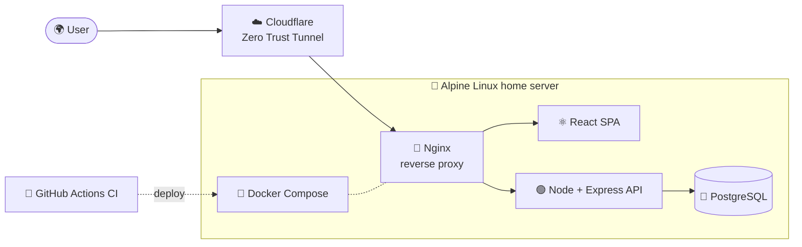

<!-- Animated wave header -->
<div align="center">
  
</div>

<!-- Typing animation -->
<div align="center">
  <a href="https://elfilaliamin.com">
    
  </a>
</div>

<br>

<div align="center">

[](https://elfilaliamin.com)
[](https://medium.com/@elfilaliamin)
[](mailto:elfilaliamin.design@gmail.com)
[](#)


</div>

---

## 👋 About me

```ts
const amin = {
  role: "Full-Stack Developer",
  base: "Tetouan, Morocco 🇲🇦",
  background: ["Industrial automation", "Electromechanical troubleshooting"],
  philosophy: "Reliable, clean, maintainable.",
  hosting: "My own Alpine Linux home server (Docker + Nginx + Cloudflare Zero Trust)",
  loves: ["Automation tools", "Browser extensions", "Workflow optimization", "Arduino & embedded C"],
  funFact: "I enjoy reverse-engineering how web apps work 😄",
  languages: { Arabic: "native", English: "professional", French: "limited working" },
  lookingFor: "Junior full-stack or backend roles focused on practical, operational problem-solving",
};
```

---

## 🚀 Featured projects

<table>
  <tr>
    <td width="50%" valign="top">
      <h3>🧾 MySirati</h3>
      <p>AI-ready career data platform. Exports granular <b>JSON Resume</b> data for AI agents (LLM job matching) with key-based access.</p>
      <p><code>React 18</code> <code>TypeScript</code> <code>Express</code> <code>PostgreSQL 16</code> <code>Drizzle</code> <code>Docker</code></p>
      <p>🔐 Argon2 · Helmet · rate limiting</p>
      <a href="https://github.com/elfilaliamin/MySirati">GitHub</a> · <a href="https://mysirati.aminlab.site/">Live</a> · <a href="https://mysirati.aminlab.site/docs/">Docs</a>
    </td>
    <td width="50%" valign="top">
      <h3>🎯 MasteryOS</h3>
      <p>Productivity and goal platform with KPI dashboards, Kanban and list views, course tracking and gamified rewards.</p>
      <p><code>React 19</code> <code>Vite</code> <code>Tailwind v4</code> <code>Express</code> <code>PostgreSQL</code> <code>GitHub Actions</code></p>
      <p>♾️ Infinite scroll · URL-persisted filters</p>
      <a href="https://github.com/elfilaliamin/MasteryOS/">GitHub</a> · <a href="https://masteryos.aminlab.site/">Live</a> · <a href="https://masteryos.aminlab.site/Docs/">Docs</a>
    </td>
  </tr>
  <tr>
    <td width="50%" valign="top">
      <h3>💰 Finance Tracker</h3>
      <p>Self-hosted personal finance platform: multi-currency wallets (cash, bank, crypto, credit), transfers, exact balance reconciliation and itemized receipts.</p>
      <p><code>React 18</code> <code>TypeScript</code> <code>Node 22</code> <code>Drizzle</code> <code>PostgreSQL 16</code> <code>VitePress</code></p>
      <p>🛡️ Argon2id · JWT in HTTP-only cookies · strict CSP</p>
      <a href="https://github.com/elfilaliamin/finance-tracker">GitHub</a> · <a href="https://finance.aminlab.site/">Live</a> · <a href="https://finance.aminlab.site/docs/">Docs</a>
    </td>
    <td width="50%" valign="top">
      <h3>🐧 Self-Hosted Linux Server</h3>
      <p>Alpine Linux home server used as a persistent staging and self-hosting environment, built from an old laptop.</p>
      <p><code>Alpine</code> <code>Docker</code> <code>Nginx</code> <code>SSH</code></p>
      <p>🔑 SSH keys · firewall · automated updates · local DNS</p>
      <a href="https://medium.com/@elfilaliamin/turn-an-old-laptop-into-a-home-server-with-alpine-linux-docker-and-portainer-09fd982daf59">Read the story on Medium</a>
    </td>
  </tr>
  <tr>
    <td colspan="2" valign="top">
      <h3>🤖 Autonomous Obstacle-Avoiding Robot</h3>
      <p>Wheeled robot built end to end: wiring, power management, sensor calibration, chassis and Arduino firmware that reads an ultrasonic sensor and steers DC motors around obstacles.</p>
      <p><code>Arduino</code> <code>C/C++</code> <code>Ultrasonic sensor</code> <code>DC motors</code> · <a href="https://www.linkedin.com/feed/update/urn:li:activity:7346212816170741770/">See it in action</a></p>
    </td>
  </tr>
</table>

---

## 🏗️ How I ship and host my apps



---

## 🧰 Tech stack

<div align="center">

**Languages & frameworks**


**DevOps & tools**


</div>

---

## 📊 Most used languages

<div align="center">
  
</div>

---

## 🤝 Let's connect

<div align="center">

I'm currently looking for **junior full-stack or backend roles**. If you've got a practical, real-world problem to solve, let's talk.

[](mailto:elfilaliamin.design@gmail.com)

[](https://medium.com/@elfilaliamin)&nbsp;&nbsp;
[](https://fb.com/med.amin.elfilali)&nbsp;&nbsp;
[](https://instagram.com/elfilali.medamin)

</div>


